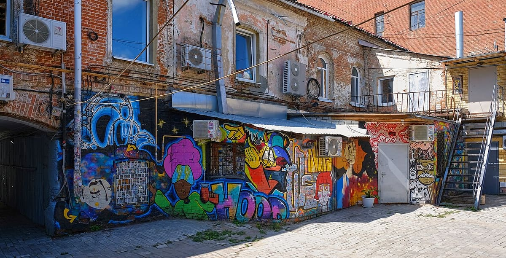

# Туристический Саратов

Единый сайт о Саратове: граффити и стрит-арт, коллекции работ, стены для художников и прогулки по городу с картой, фильтрами, маршрутами и аудиогидом.

**Сайт:** [saratovguide.ru](https://saratovguide.ru)



## Разделы

- **Лента** — главный экран: все объекты города в одном потоке — места, здания, граффити и коллекции работ.
- **Карта** — прогулка по городу: карта, объекты рядом, фильтры по типу, карточки мест и аудиогид.
- **Стены** — свободные поверхности для художников с контактом владельца и модерацией.
- **Профиль** — единый аккаунт: маршруты, избранные места и маршруты, стены, добавленные здания и подписки.

## Что умеет

### Лента и коллекции

- единая лента: места, здания и граффити с фотографиями, адресами и фильтром по типу;
- у граффити — сохранность, стиль, лайки, дизлайки и комментарии с ответами;
- заявки на новые граффити и сообщения об изменении статуса работы;
- коллекции работ с обложками и публичными подборками;
- раздел «Стены»: владелец публикует фасад, гараж или забор, указывает условия и контакт;
- модерация всех заявок в админ-панели;

### Прогулка

- карта Leaflet/OpenStreetMap с фотометками и GPS-положением;
- лента объектов: все здания без GPS или ближайшие в радиусе 200 метров с GPS;
- фильтр объектов по типу: архитектура, история, искусство, природа, стрит-арт;
- карточки с фото, адресом, расстоянием, описанием и источниками;
- маршруты горожан: создание, обложки, длительность, лайки, комментарии и избранное;
- избранные места и маршруты в едином профиле; места сохраняются в браузере, маршруты — в аккаунте;
- сортировка маршрутов по близости и кнопка «Ближайшие» с запросом GPS;
- аудиогид, план прогулки и построение пешеходного маршрута;
- ссылка на маршрут до объекта в Яндекс Картах;
- PWA-режим и кэш уже загруженных материалов.

### Своё здание

- кнопка **«Добавить своё здание»** под кнопкой «Начать прогулку»;
- форма: название, адрес, тип, описание, фото и точка на карте;
- заявка проходит модерацию, как граффити и стены;
- после одобрения здание появляется на карте и в ленте;
- в профиле показываются свои здания со статусами «на проверке», «опубликовано» и «отклонено».

### Модерация

- отдельные вкладки для граффити, стен, зданий, статусов и пользователей;
- публикация и отклонение заявок с причиной;
- редактирование и удаление работ;
- доступ только аккаунту с ролью `admin`.

## Технологии

- **Frontend:** React 19, TypeScript, Vite, React Router.
- **Backend:** Node.js, Express 5, better-sqlite3, JWT/cookie-аутентификация, multer, sharp.
- **Прогулка:** ванильный JavaScript, Leaflet, OpenStreetMap, service worker.
- **Хранение:** один SQLite-файл, изображения — в таблице `media`.
- **Продакшен:** Nginx, HTTPS, systemd.

## Структура репозитория

```text
.
├── graffiti/          # React-приложение, API и админка
│   ├── server/        # Express, SQLite, модерация, загрузка фото
│   ├── src/           # страницы, компоненты и стили
│   └── public/        # favicon, OG-изображение
├── ryadom/            # прогулка: карта, маршруты, аудиогид, PWA
│   ├── data/          # каталог мест
│   ├── app.js         # карта, геолокация, карточки
│   ├── experience.js  # маршруты, профиль, коллекции, заявки
│   └── style.css      # оформление прогулки
└── README.md
```

## Локальный запуск

Требуется Node.js 20+.

```bash
cd graffiti
npm install
cp .env.example .env   # секреты и настройки сервера
npm run dev
```

- сайт: `http://localhost:5173`
- главная «Лента»: `http://localhost:5173/#/`
- карта: `http://localhost:5173/#/map`
- API: `http://localhost:3001`

Отдельный запуск прогулки без общего сайта:

```bash
cd ryadom
python3 server.py
```

- автономная версия: `http://127.0.0.1:8765`

## Деплой

Production-сборка:

```bash
cd graffiti
npm ci
npm run build
NODE_ENV=production npm start
```

На сервере приложение работает из `/opt/saratovguide`, Nginx проксирует запросы на `127.0.0.1:3001`, процесс управляется systemd-сервисом `saratovguide`.

## Документация

- [graffiti/README.md](graffiti/README.md) — API, модерация и работа с базой.
- [ryadom/README.md](ryadom/README.md) — карта, GPS, маршруты и аудиогид.

## Лицензия

[AGPL-3.0](LICENSE).

---

product by team «НАПИШИ 123» © 2026
