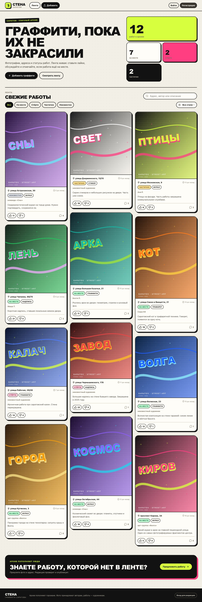
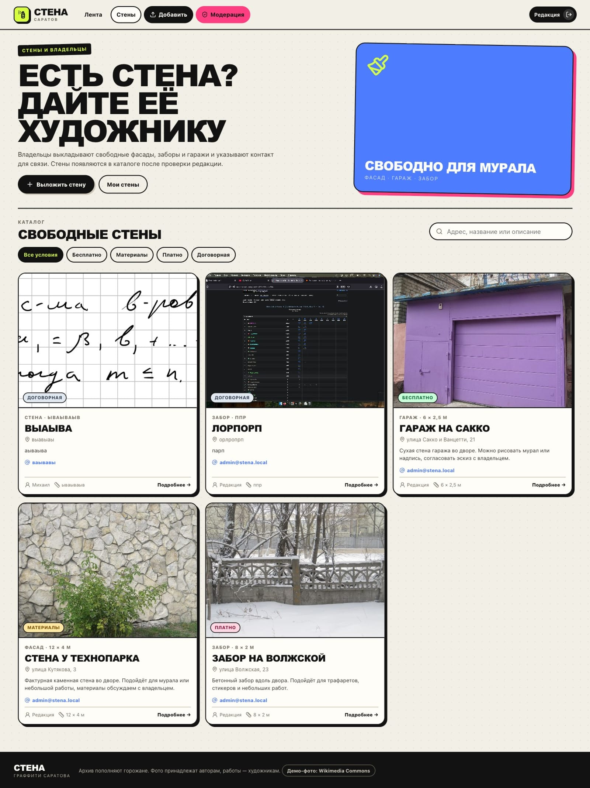
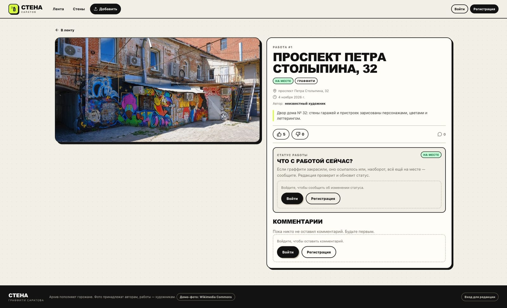
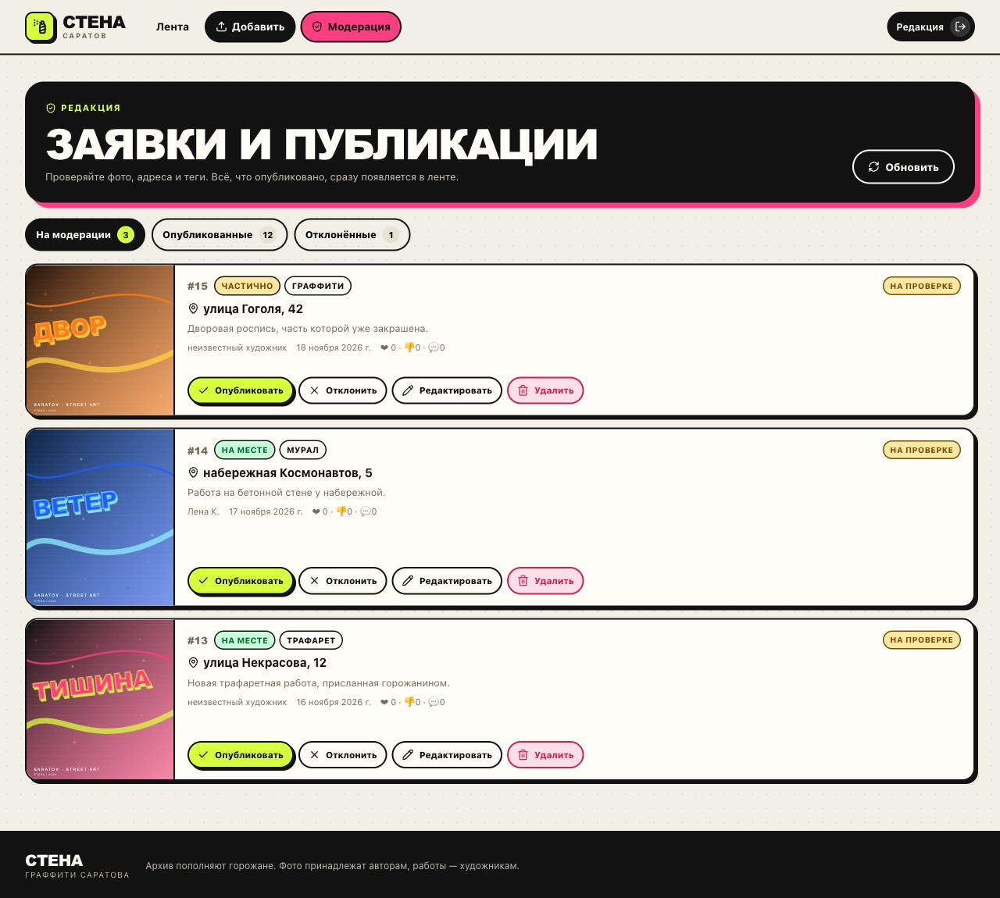

# Туристический Саратов — лента, карта и модерация

Единое приложение: лента всех городских объектов, карта, маршруты, коллекции, стены и профиль. Пользователи присылают материалы, редакция проверяет их в админ-панели, которая доступна только после входа.

Приложение лежит в `graffiti/`.



Демо-фото: [Wikimedia Commons](https://commons.wikimedia.org/wiki/Category:Graffiti_in_Saratov); авторы и лицензии — в [CREDITS.md](CREDITS.md).

<p align="center">
  
</p>

## Что уже работает

- **Публичная лента** — места, здания и граффити в одном потоке, с фото, адресом и фильтром по типу.
- **Карта** — Leaflet/OpenStreetMap, маркеры объектов, поиск, геолокация и «Моя прогулка».
- **Два тега** — статус (`на месте / стёрто / частично / неизвестно`) и стиль (`мурал / граффити / трафарет / стикер / надпись / другое`).
- **Регистрация и вход** — имя, email, пароль; имя подставляется в комментарии и заявки.
- **Лайки и дизлайки** — один голос на аккаунт, повторное нажатие снимает реакцию.
- **Комментарии** — от имени аккаунта; автор может удалить свой комментарий, администратор — любой.
- **Заявка на изменение статуса** — пользователь может сообщить, что работа стёрта, частично закрашена или всё ещё на месте; редакция подтверждает изменение.
- **Маршруты** — опубликованные прогулки, остановки, комментарии и избранное.
- **Аудиогид** — записи Дениса для объектов в карточке места.
- **Стены для художников** — владельцы публикуют свободные фасады, гаражи и заборы и указывают контакт для связи; стена появляется в каталоге после проверки редакции.
- **Отправка фото** — JPG/PNG/WEBP до 10 МБ, адрес, теги, описание, подтверждение прав. Поля «Имя» в форме нет.
- **Модерация** — заявки на граффити и стены не появляются в ленте и каталоге до одобрения.
- **Скрытая админ-панель** — вкладки «На модерации», «Опубликованные», «Отклонённые» для граффити, отдельные вкладки «Стены», «Здания» и «Статусы»; публикация, отклонение с причиной, редактирование и удаление.
- **Доступ** — ссылка «Модерация» и `/#/admin` доступны только аккаунту с ролью `admin`; остальным отдаётся 404. API тоже закрыт на сервере.
- **Адаптивность** — от 320 до 1920 px: 1–4 колонки ленты, перестроение шапки, карточек и админки.
- **Демо-сид** — наполнение ленты, стен и коллекций для локальной проверки.

## Быстрый старт

```bash
cd graffiti
npm install
npm run dev
```

- веб: `http://localhost:5173`
- API: `http://localhost:3001`
- лента объектов: `http://localhost:5173/#/`
- арт-прогулка: `http://localhost:5173/#/map`

Если сайт не открывается или пишет «что-то пошло не так», проверьте, что запущены **оба** процесса: API и Vite. Порт `5173` строгий: если он занят, Vite не будет молча переезжать.

Занятые порты можно освободить так:

```bash
lsof -ti :5173 :3001 | xargs kill
npm run dev
```

## Регистрация и вход

Регистрация — три поля: **имя, email, пароль**. После входа можно ставить лайки, писать комментарии и присылать работы.

```
/#/register — создать аккаунт
/#/login    — войти
```

В комментариях и заявках на граффити используется имя из аккаунта, отдельного поля «Имя» нет.

### Админ

Админка встроена в сайт и открывается только для аккаунта с ролью `admin`: после входа в шапке появляется «Модерация», а `/#/admin` показывает панель. В панели есть вкладки для граффити, стен и отчётов о статусе. Для остальных пользователей и гостей этот раздел отдаёт 404, API тоже закрыт на сервере.

Пароль администратора не хранится в коде. Он задаётся в `.env`:

```env
ADMIN_NAME=Редакция
ADMIN_EMAIL=admin@stena.local
ADMIN_PASSWORD=придумайте-сложный-пароль
```

Если `ADMIN_PASSWORD` не задан при первом запуске, сервер сгенерирует случайный пароль и выведет его в консоль один раз. При изменении `ADMIN_PASSWORD` пароль администратора обновится при следующем запуске.

Перед публикацией поменяйте данные в `.env`:

```bash
cp .env.example .env
```

```env
PORT=3001
COOKIE_SECRET=длинная-случайная-строка
JWT_SECRET=ещё-одна-длинная-строка
ADMIN_NAME=Редакция
ADMIN_EMAIL=admin@stena.local
ADMIN_PASSWORD=новый-пароль
```

После смены пароля в `.env` перезапустите сервер — хеш в базе обновится автоматически.

## Стены

- `/#/walls` — каталог свободных стен.
- `/#/walls/new` — форма для владельца: фото, адрес, контакт, тип, размер, условия.
- `/#/walls/:id` — карточка стены с контактом владельца.
- `/#/account` — «Мои стены».

Владелец указывает контакт при публикации: телефон, email, Telegram, ВК или другой удобный способ. Стена сначала попадает на проверку редакции и появляется в каталоге только после одобрения. Контакт показывается в карточке стены, чтобы художник мог связаться напрямую. Внутренних диалогов и заявок на сайте больше нет.



## Скриншоты

| Карточка работы | Админка |
|---|---|
|  |  |

## Как устроено

```
graffiti/
  server/
    index.js      Express API, auth, загрузка, модерация
    image-check.js хеши изображений и служебные проверки
    seed-images/  реальные фото Саратова для демо-ленты + credits.json
    db.js         SQLite-схема, сиды, демо-стены
  src/
    pages/        Лента, карточка, стены, кабинет, вход, админка
    components/   Header, карточки, WallCard, guard
    context/      AuthContext — сессия пользователя
    lib/          API-клиент, типы, константы
  content/
    places.json   каталог мест
    photos.json   авторы и лицензии фотографий
  public/
    places/       фотографии мест
    audio/        аудиогид
  data/
    stena.db      вся база: пользователи, работы, реакции,
                  комментарии, стены, контакты и изображения (BLOB)
```

### API

| Метод | Путь | Доступ |
|---|---|---|
| `POST` | `/api/auth/register` | публично |
| `POST` | `/api/auth/login` | публично |
| `POST` | `/api/auth/logout` | публично |
| `GET` | `/api/auth/me` | публично, возвращает `user: null` |
| `GET` | `/api/feed` | публично |
| `GET` | `/api/graffiti/:id` | публично |
| `GET` | `/api/media/:id` | публично, изображение из SQLite |
| `POST` | `/api/graffiti/:id/reaction` | только авторизованный |
| `POST` | `/api/graffiti/:id/comments` | только авторизованный |
| `POST` | `/api/graffiti/:id/status-reports` | только авторизованный |
| `DELETE` | `/api/comments/:id` | автор комментария или админ |
| `POST` | `/api/submissions` | только авторизованный, multipart |
| `GET` | `/api/walls` | публично |
| `GET` | `/api/walk-route` | публично, расстояние по дорогам OSM |
| `GET` | `/api/walk-places` | публично, каталог объектов прогулки |
| `GET` | `/api/walls/:id` | публично; стена на модерации — только владелец или админ |
| `POST` | `/api/walls` | только авторизованный, multipart; нужен `contact` |
| `PATCH` | `/api/walls/:id` | владелец или админ |
| `DELETE` | `/api/walls/:id` | владелец или админ |
| `GET` | `/api/my/walls` | только авторизованный |
| `GET` | `/api/admin/graffiti` | только админ |
| `GET` | `/api/admin/walls` | только админ |
| `POST` | `/api/admin/walls/:id/approve` | только админ |
| `POST` | `/api/admin/walls/:id/reject` | только админ |
| `GET` | `/api/admin/status-reports` | только админ |
| `POST` | `/api/admin/status-reports/:id/approve` | только админ |
| `POST` | `/api/admin/status-reports/:id/reject` | только админ |
| `POST` | `/api/admin/graffiti/:id/approve` | только админ |
| `POST` | `/api/admin/graffiti/:id/reject` | только админ |
| `PATCH` | `/api/admin/graffiti/:id` | только админ |
| `DELETE` | `/api/admin/graffiti/:id` | только админ |
| `DELETE` | `/api/admin/comments/:id` | только админ |

Сессия пользователя — JWT в httpOnly-cookie на 30 дней. Один аккаунт — один голос; имя из профиля используется в комментариях и заявках.

`POST /api/walls` принимает обязательное поле `contact` — телефон, email, Telegram, ВК или другой контакт. Оно показывается в карточке стены.

### Безопасность

- Пароли хранятся как bcrypt-хеши, email сравнивается без учёта регистра.
- Админ-маршруты защищены ролью в сессии; при отсутствии роли API отвечает `404`, чтобы не раскрывать раздел.
- Пароль администратора не хранится в коде: он задаётся через `ADMIN_PASSWORD` в `.env`, при первом запуске без него генерируется случайный.
- Публичная лента отдаёт только `moderation_status = 'published'`.
- Публичный каталог стен отдаёт только стены с `moderation_status = 'published'` и статусом `open`.
- Загружаются только JPEG/PNG/WEBP, лимит 10 МБ.
- Есть простые лимиты на комментарии и отправку работ.
- Имена файлов генерируются на сервере, исходное имя не используется.
- Для продакшена поставьте HTTPS и включите `secure` у cookie.

## Production

```bash
cd graffiti
npm run build
npm start
```

Express отдаст `dist/` и API на одном порту (`3001` по умолчанию). Все данные и загруженные фото лежат в одном файле `data/stena.db`; для бэкапа достаточно скопировать его. На serverless-платформах с эфемерной файловой системой SQLite не сохранится — нужен VPS/Render/Railway/Fly с постоянным диском.

## Ограничения текущего MVP

- Нет подтверждения email и восстановления пароля.
- Нет карты и геокодирования адреса.
- Нет PWA и push-уведомлений.
- Нет внутренних диалогов по стенам: связь идёт по контакту, который указал владелец.
- Демо-фото ленты — реальные снимки Саратова с Wikimedia Commons; авторы и лицензии перечислены в [`CREDITS.md`](CREDITS.md). Пользовательские фото сохраняются в SQLite как BLOB и отдаются через `/api/media/:id`.

## Лицензия

AGPL-3.0, как и у остального репозитория. См. `../LICENSE`.
